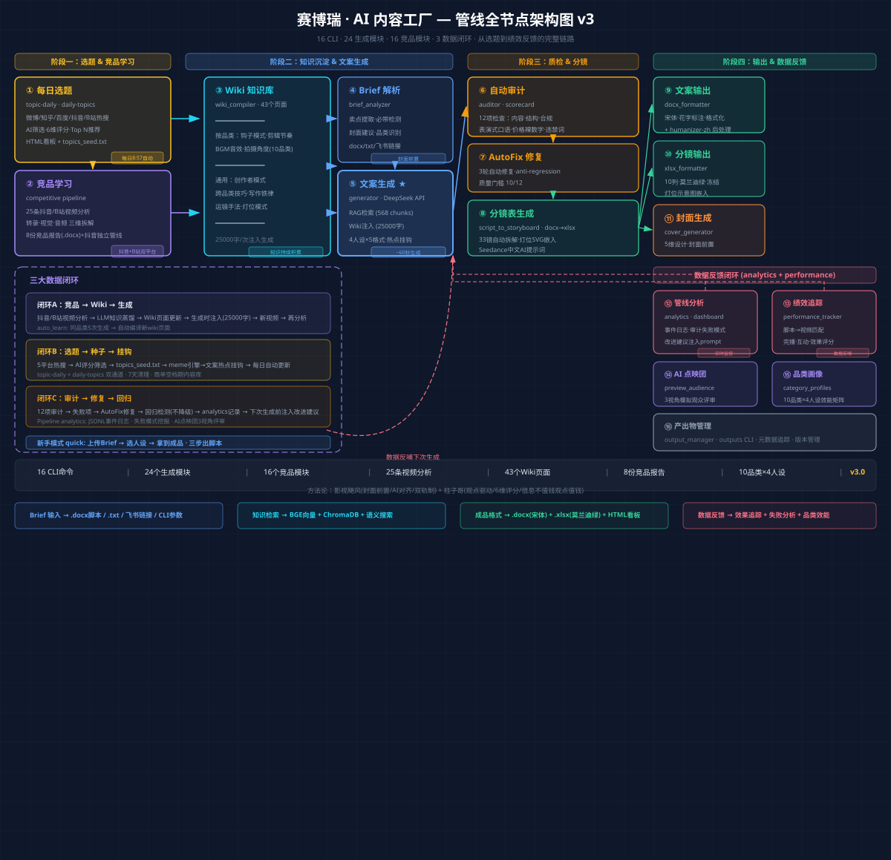
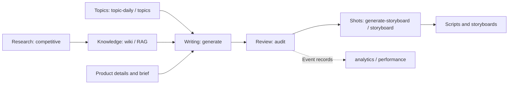
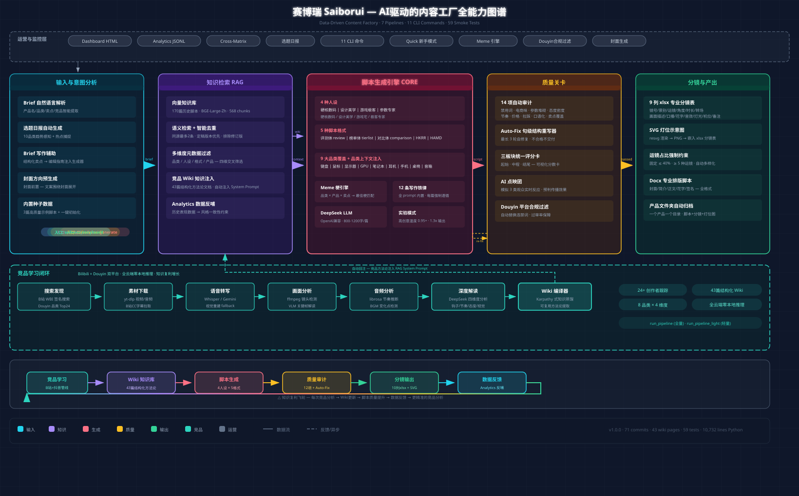

# Saiborui: Architecture and Showcase

[中文](showcase.md) · [Home](../README.en.md)

Saiborui connects topic planning, competitive research, knowledge retrieval, writing, production preparation, and feedback for short-form technology videos.

The diagram is an existing **June 10, 2026 historical snapshot**, in Chinese. Counts, timings, schedules, and feature descriptions are historical claims, not live measurements. Check the code and CLI help for current behavior.

## The workflow

This logical view follows the current repository's CLI entry points and modules. Arrows describe workflow relationships; they do not imply that every path is automatically connected end to end.

1. **Topics and research:** gather topic leads and analyze comparable content.
2. **Knowledge and writing:** combine Wiki material, retrieval from past content, and a product brief to draft scripts.
3. **Review and storyboarding:** check the draft, assist revision, and prepare shot lists and lighting references.
4. **Output and feedback:** organize deliverables and use pipeline and performance data to inform later work.

The design also shows feedback loops for competitor knowledge, topic leads, and review. Actual operation depends on external services, inputs, and configuration.

## Capability map

This map dates to June 1, 2026. It illustrates the module structure at that time; its figures should not be compared directly with the later pipeline snapshot.

## Topic report: illustrative format

A local daily report dated July 1, 2026 contains 10 candidate topics, including source platform, ranking, score, and proposed angle. Third-party trending headlines are not republished here. They are historical, not current trends.

Three previously published Chinese Word scripts are available in the repository: [keyboard guide](../examples/磁轴键盘选购指南-折腾到吐.docx), [lightweight mouse guide](../examples/轻量化鼠标怎么选-折腾到吐.docx), and [student laptop guide](../examples/学生党618笔记本怎么选-折腾到吐.docx). These are historical examples; verify product claims and prices before reuse.

The structure follows an existing daily report. The topics, ranking, and scores below are fictional and do not represent real trends or product findings.

| Rank | Topic | Source | Score | Angle |
| --- | --- | --- | --- | --- |
| 1 | What to look for in a wireless keyboard | Example source | 85 | Buying guide |
| 2 | How refresh rate affects monitor use | Example source | 78 | Explainer |
| 3 | First steps with a new computer | Example source | 72 | Practical guide |

## Storyboard: illustrative format

A local storyboard test workbook contains separate shot-list and lighting sheets. The following is a translation of two actual test rows; some columns have been omitted. This is a test, not a client deliverable.

| Shot | Framing | Visual | Narration | Duration | Lighting |
| --- | --- | --- | --- | --- | --- |
| 1 | Wide, push in | Overhead view of three keyboards | Today we're reviewing this 399-yuan magnetic-switch keyboard. | 5 seconds | Key-to-fill ratio about 3:1 |
| 2 | Close-up, push in | Close-up of switch | What exactly is a magnetic switch? | 3 seconds | Key-to-fill ratio about 3:1 |

Based on the structure of a local storyboard test, with fictional product details and narration; this is not a client deliverable.

| Shot | Framing and movement | Visual | Narration | Lighting |
| --- | --- | --- | --- | --- |
| 1 | Medium, slow push | Creator introduces desk equipment | Let's talk about choosing a keyboard. | Key light and fill |
| 2 | Fixed close-up | Show keys and ports | Start with layout and connectivity. | Soft detail lighting |
| 3 | Overhead pan | Demonstrate everyday use | Choose for the way you work. | Soft overhead light |

## Evidence and boundaries

Earlier portfolio materials claim efficiency multiples, but independently verifiable test records have not been found. They are therefore omitted here. The examples exclude client briefs, private materials, and credentials. Review model output and third-party content before publication.
