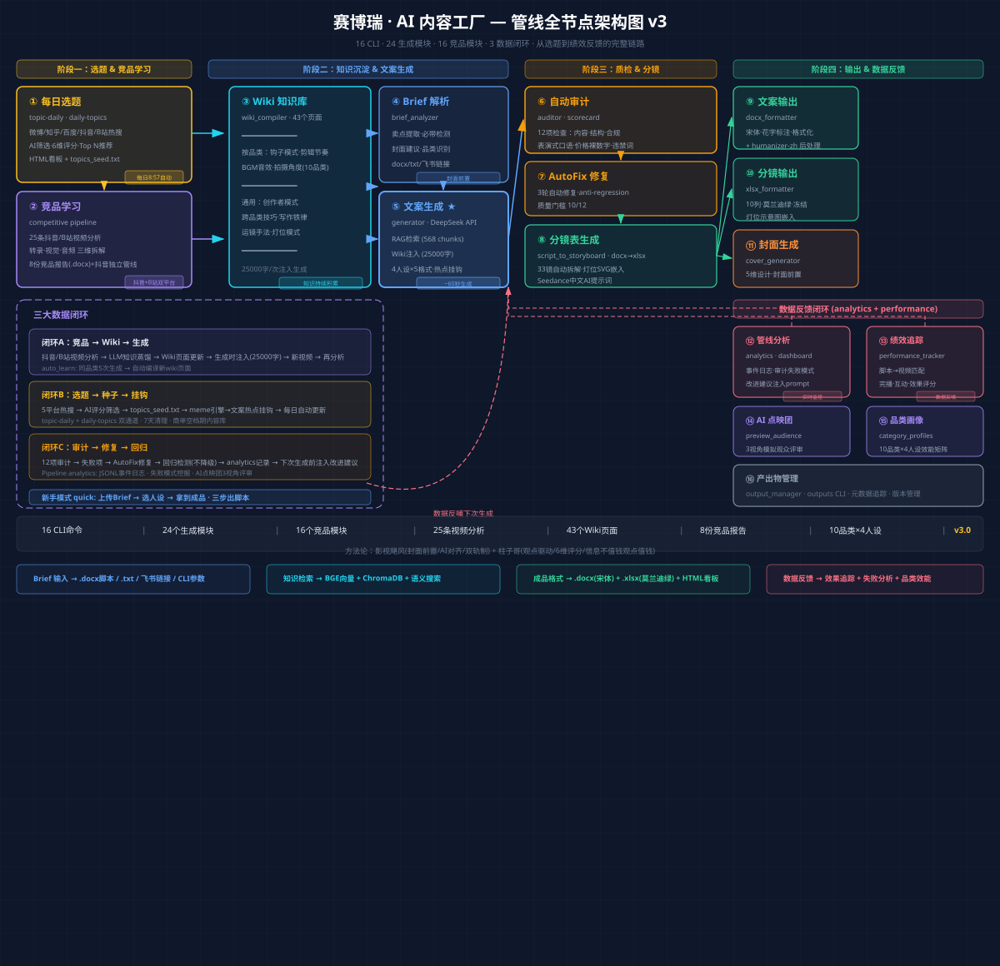
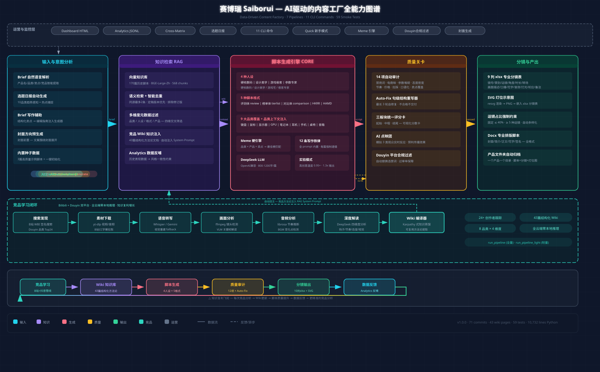

# 赛博瑞：管线与作品展示

[English](showcase.en.md) · [返回首页](../README.md)

赛博瑞围绕数码短视频创作，把选题、研究、写作、拍摄准备与反馈串联起来。下图保留项目现有的全节点架构图，便于查看各模块之间的关系。

**版本说明：** 图为 2026 年 6 月 10 日的历史设计快照。节点中的数量、时间、任务频率、效果和能力描述并非当前运行结果；请以代码和命令帮助为准。

## 全链路如何协作

1. **选题与竞品：** 汇集热点和竞品资料，形成选题方向与分析报告。
2. **知识与文案：** 结合 Wiki、历史内容检索和产品 Brief，生成不同格式的脚本。
3. **审核与分镜：** 检查内容质量，辅助修订，并把脚本转成镜头表和灯位参考。
4. **输出与反馈：** 整理脚本、分镜等产物，记录管线信息并结合效果分析，为后续创作提供参考。

架构图还展示了竞品知识回流、选题线索回流和审核修订三个设计闭环。外部服务、输入数据及配置会影响实际运行。

## 能力地图

这张能力地图来自 2026 年 6 月 1 日，用于展示当时的模块分工；它与上方 v3 图不是同一时间的快照，数字不应直接比较。

## 选题日报：格式示例

本示例根据现有日报的字段结构重新编写，话题、排序与评分均为虚构，用于展示格式，不代表实际热点或产品结论。

| 排名 | 话题 | 来源 | 分数 | 内容方向 |
| --- | --- | --- | --- | --- |
| 1 | 无线键盘选购要看哪些参数 | 示例平台 | 85 | 消费向导 |
| 2 | 显示器刷新率如何影响使用体验 | 示例平台 | 78 | 科普解读 |
| 3 | 新电脑到手后的基础设置 | 示例平台 | 72 | 实用教程 |

本地日报通常包含日期、平台、话题、排名、评分与建议方向。原始热点内容可能涉及第三方来源，发布前仍需核实。

## 分镜表：格式示例

本示例参照本地分镜测试表的镜头与灯位结构重写，产品和文案均为虚构，不是客户成片。

| 镜号 | 景别与运镜 | 画面 | 口播 | 灯光 |
| --- | --- | --- | --- | --- |
| 1 | 中景，缓推 | 创作者介绍桌面设备 | 今天聊聊如何选择键盘。 | 主灯前侧，辅灯补光 |
| 2 | 特写，固定 | 展示按键和接口 | 先看布局与连接方式。 | 柔光突出细节 |
| 3 | 俯拍，平移 | 手部演示日常使用 | 再根据自己的使用场景判断。 | 顶部柔光 |

## 数据与边界

项目现有作品集曾提到多项效率倍数，但目前没有找到可独立复核的测试记录，故此处不将它们作为事实引用。项目示例不包含客户 Brief、私人素材或凭据；模型输出和第三方内容仍需人工核实。
